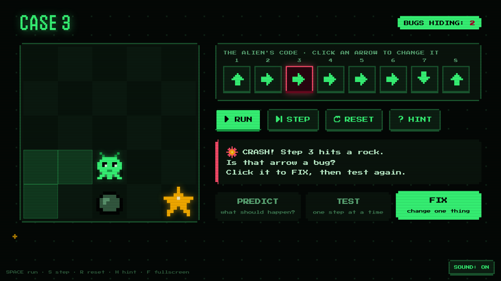

# Bug Detectives 

A pixel-art game I made for a demo, to help young learners understand debugging: find the bug, fix the code, reach the star.



**▶ Play it:** https://bugdetectives.angelaparahinog.com

## What it teaches

Computers do *exactly* what we tell them, even when we're wrong. Each case gives a little alien a list of arrow instructions with a few bugs hidden in them. Kids work out what's wrong and fix it using the **Detective Method**:

1. **Predict:** what *should* the alien do?
2. **Test:** run the code one step at a time to find where it goes wrong.
3. **Fix:** change one thing, then test again.

## How to play

- Click an arrow to change its direction.
- **Run** plays the whole code. **Step** runs one instruction at a time.
- **Hint** highlights an arrow worth a closer look.
- Get the alien to the star without walking off the board or crashing into a rock.

| Case | Challenge |
|---|---|
| 1 | One bug |
| 2 | Two bugs |
| 3 | Two bugs plus rocks: a wrong arrow sends the alien crashing into a rock|

After the first playthrough, **Play Again** generates three new random cases each time, so it never runs out of puzzles.

**Keyboard:** `Space` run · `S` step · `R` reset · `H` hint · `F` fullscreen

## Run it locally

No install or internet needed. Download the repo (Code → Download ZIP), unzip it, and open `index.html` in any modern browser.

## Project structure

```
index.html        screens and buttons
css/style.css     all styling
js/sprites.js     pixel art (alien, star, arrows, icons)
js/levels.js      hand-made cases and the random level generator
js/effects.js     sound, background, confetti
js/game.js        the game loop: run, step, crash, win
fonts/            fonts and their licences
```

## Built with

- Plain HTML, CSS and JavaScript (no frameworks, no build step)
- Pixel sprites drawn from text maps and rendered as inline SVG (no image files)
- Sound effects generated with the Web Audio API

## How it was made

I made this project from start to finish: I designed the teaching approach and visuals, coded the mechanics, and deployed it live on Cloudflare Pages. At its heart is a core loop (predict → run → spot where it goes wrong → fix one thing → test again), which mirrors how real debugging works.

The idea was inspired by the arrow-path puzzles on [Code.org](https://code.org).

## Credits

- Fonts: [Press Start 2P](https://fonts.google.com/specimen/Press+Start+2P) by CodeMan38 and [Handjet](https://fonts.google.com/specimen/Handjet) by Rosetta, both under the SIL Open Font License
- Made by [Angela Parahinog](https://angelaparahinog.com)
